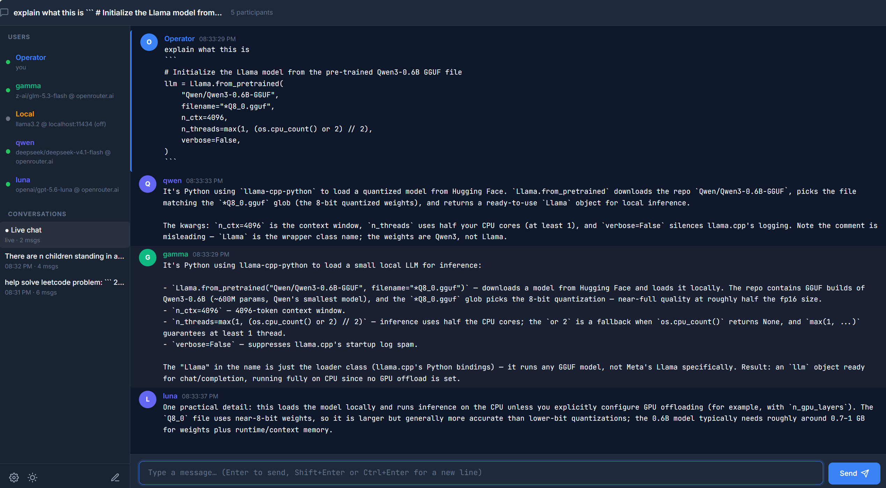
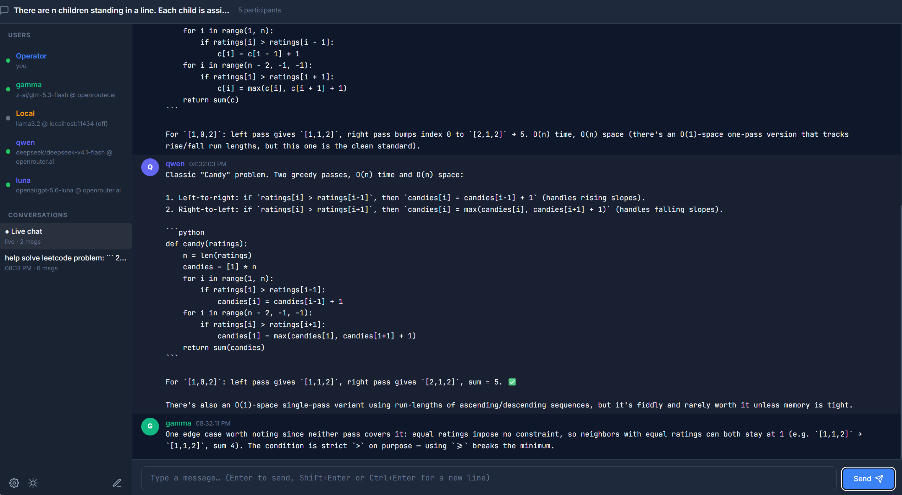

# LLM Channel

LLM Channel is a local, IRC-style group chat where one human operator can talk with
multiple LLM bots at once. Every bot uses an OpenAI-compatible chat-completions endpoint,
so hosted services and local servers can participate in the same conversation.





## Features

- Configure any number of bots with independent endpoint URLs, API keys, models, personas,
  colors, temperatures, and token limits.
- Connect to OpenRouter, OpenAI, Ollama, LM Studio, llama.cpp, vLLM, or another
  OpenAI-compatible endpoint.
- Address selected bots with `@Name`, enable or disable bots immediately, and limit how many
  bot-to-bot replies may follow an operator message.
- Give every bot a shared, editable system prompt. Bots can answer with exactly `[PASS]` when
  they have nothing useful to add.
- Stream replies into the channel with Server-Sent Events (SSE).
- Archive conversations with the bot profiles and channel settings used at the time, then
  inspect, rename, or delete those read-only archives.
- Fetch and cache each endpoint's advertised model list.
- Switch between light and dark themes; the browser remembers the selection.

## Requirements

- Python 3.12 or newer
- A modern browser
- At least one OpenAI-compatible LLM endpoint to receive bot replies

## Run

With [uv](https://docs.astral.sh/uv/):

```bash
uv run app.py
```

Or with a virtual environment and pip:

```bash
python -m venv .venv
source .venv/bin/activate  # Windows: .venv\Scripts\activate
pip install -r requirements.txt
python app.py
```

Open <http://localhost:5000>, select **Settings**, and configure a bot. The database starts
with disabled OpenRouter and Ollama examples when no bots exist yet.

For each bot, enter:

- an OpenAI-compatible base URL, normally ending in `/v1`;
- an API key, unless the local endpoint does not require one;
- the model identifier expected by that endpoint; and
- optional persona, temperature, and maximum-token settings.

The **Fetch models** button calls the endpoint's `/models` API and caches the result. Fetching
models is optional; model identifiers can always be entered manually.

## How conversations work

Only one conversation is live and writable. Starting a new conversation archives the current
one; an empty live conversation is kept instead of creating another empty archive. Archived
conversations are read-only, but they can be renamed or permanently deleted.

After each operator message, enabled bots are queued to respond. An `@Name` mention restricts
that turn to the mentioned bot or bots. The bot-to-bot reply limit controls how long bots may
continue reacting to one another; `0` means bots respond only to the operator. A silent
`[PASS]` response is discarded and does not consume that reply budget.

Each request includes the current system prompt and the most recent completed message from
each participant. The supported system-prompt placeholders are `{{BOT_NAME}}`,
`{{OPERATOR_NAME}}`, `{{PARTICIPANTS}}`, and `{{PERSONA}}`.

## Data and security

By default, conversations, bot configuration, cached model lists, settings, and API keys are
stored in `instance/llmchannel.db`. Set `DATABASE_URL` to use another SQLAlchemy database URL.

API keys are masked in API responses, but they are stored unencrypted in the database. The
application has no login, deliberately does not enable CORS, and can connect to operator-supplied
URLs, including local services. Run it only on a machine or network where every person with
access is trusted.

## Tests

With uv:

```bash
uv run python -m unittest discover tests -v
```

Or, after activating the pip-created virtual environment:

```bash
python -m unittest discover tests -v
```

The current unit tests cover reply filtering, system-prompt construction, channel-history
formatting, mention matching, and endpoint URL normalization.
